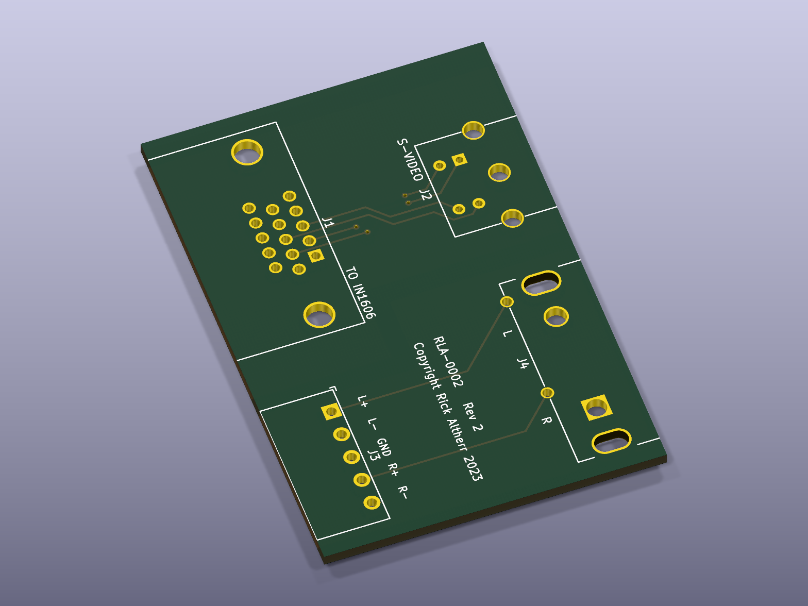

# RLA-0002: S-Video adapter for Extron IN1606

A small, passive breakout board for connecting an S-video source and stereo
analog audio to an Extron IN1606 scaling presentation switcher.

The IN1606's two analog video inputs use 15-pin HD (VGA-style) connectors. They
accept S-video, but there's no 4-pin Mini-DIN jack to plug a source into. This
board routes a standard S-video Mini-DIN onto the HD-15 pins the IN1606 expects
for S-video. It also breaks out stereo audio between RCA jacks and a 3.5 mm
5-position terminal block.

## Specifications

- 2-layer, 1.6 mm FR-4, 43.18 × 63.5 mm
- All through-hole parts; no active components
- Designed in KiCad 10

## Connectors

| Ref | Function             | Part                                   |
|-----|----------------------|----------------------------------------|
| J1  | HD-15 to IN1606      | Amphenol L77HDE15SD1CH4F               |
| J2  | S-video (Mini-DIN 4) | TE Connectivity 5749181-1              |
| J3  | Audio header         | TE Connectivity 284512-5 (3.5 mm, 5-pos) |
| J4  | Audio RCA (L/R)      | CUI Devices RCJ-2123                   |

## Pinout

### Video

| Signal        | J2 (Mini-DIN) | J1 (HD-15) |
|---------------|:-------------:|:----------:|
| Luma (Y)      | 3             | 2          |
| Luma return   | 1             | 7          |
| Chroma (C)    | 4             | 3          |
| Chroma return | 2             | 8          |
| Ground        | shell         | 10, shell  |

All other HD-15 pins are unconnected.

### Audio

| Signal       | J4 (RCA) | J3 (header)         |
|--------------|:--------:|:-------------------:|
| Left         | 4        | 1                   |
| Right        | 2        | 4                   |
| Audio ground | 1, 3     | 2, 3, 5             |

Audio ground is kept separate from the video/chassis ground.

J3 is a pluggable header. It mates with a TE 284506-5 (or compatible 3.5 mm
5-position) screw-terminal plug, which you wire pin-for-pin to the IN1606's
5-pole audio input plug (L+, L−, ⏚, R+, R−). This matches Extron's
unbalanced input wiring.

## Revision history

- **Rev 2:** Fixed the S-video jack (J2) footprint, whose signal pins were
  mirrored left-to-right, and rerouted the video traces. Also plated the RCA
  mounting-tab slots, adjusted pad and drill sizes, added silkscreen labels,
  and set design rules for OSH Park's 2-layer service.
- **Rev 1:** Original fabricated board. J2's pinout is reversed; installing
  the jack on the bottom side of the board corrects it.

## Repository layout

- `rla-0002.kicad_pro`, `.kicad_sch`, `.kicad_pcb`: KiCad project
- `rla-0002.pretty/`: custom footprints for the connectors above. The project
  library table (`fp-lib-table`) loads them automatically.

## License

TBD
